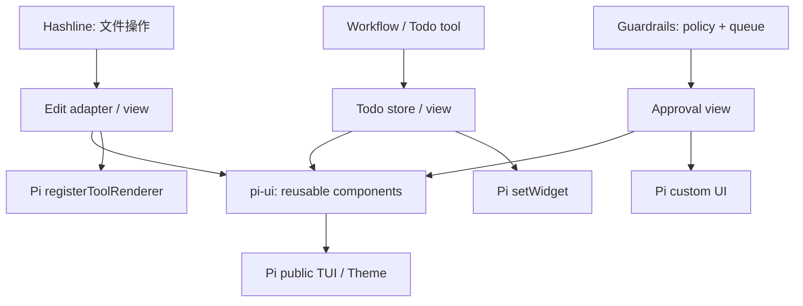

# Pi UI Kit — 完整实施计划

- 文档版本：v1.2
- 日期：2026-11-24
- 状态：待 Phase 0 验证；共享基础与各功能按各自门禁进入开发
- 目标：在不 Fork 原生 Pi 的前提下，以统一组件库实现 OMP 风格 Edit、TODO HUD 和危险操作确认框，并兼容现有 `@jackice/hashline`。
- 交付形式：单仓库、单核心 npm library，业务扩展保持独立；不要求一次发布多个 package。

## 1. 范围与架构决策

### 1.1 必须交付

1. 通用 UI 库 `@jackice/pi-ui`：主题映射、ANSI 安全布局、Panel、StatusLine、CodeFrame、TreeList、Dialog，以及按实际需要提供的选择/滚动组件。
2. Edit：接入现有 Hashline，显示实际执行 Diff、文件路径、增删统计、新旧行号、缩进、上下文高亮、折叠/展开及错误状态。
3. TODO：独立的 `session_todo` 工具、Session 分支恢复、与项目级 `todo` 共存、输入框上方常驻树形 HUD；支持串行及显式并行任务。
4. Approval：替换现有 Guardrails/Permission Gate 在已验证执行入口上的确认 UI，提供完整命令查看、明确批准/拒绝、取消与超时安全处理。
5. Gallery、单元测试、快照测试、真实 Pi 集成测试、性能报告、使用及升级文档。

### 1.2 非目标

不重写 Hashline Patcher；不实现新的 Agent、Composer、Editor、终端驱动、全局事件总线、数据库、权限引擎、Workflow 调度器。暂不实现 OMP native host/TSP、Bun/Rust native binding、持久授权 UI、流式模拟 patch、Read/Write/Bash 全量美化。后续需求必须单独立项。首版不追求 OMP 所有像素细节。

### 1.3 冻结的依赖边界



- UI 库不注册工具、不持久化业务数据、不读取工作区文件、不批准命令、不持有 AgentSession。
- Edit renderer 属于 Hashline 集成层或独立 renderer 扩展；TODO store 由独立 TODO 扩展管理；Approval 请求及授权生命周期由现有 Guardrails 管理。
- 业务扩展可消费 UI 组件，但 UI 库不得反向 import 业务扩展。
- 纯展示组件可被多个扩展共享；业务 view 仅在真正有第二个调用方时再提取。
- 不引入 React、虚拟 DOM、自建渲染循环、独立 UI 进程。保留 Pi 原生键盘、焦点、主题、展开机制。

## 2. Phase 0 — 源码与兼容性门禁（阻断项）

静态审阅基线为本机 Pi `1.6.0`、Node `v25.9.0` 和 `@jackice/hashline` `0.1.1`。Pi 安装包声明了 `registerToolRenderer`、`setWidget`、`custom<T>` 和 `appendEntry`。已安装的 Hashline 注册 `hashline`，通过 `tool_result` hook 改写 `read` 结果，当前 `hashline` 返回空 `details`。dotfiles 已有项目级 `todo`、`/todos`，现有 Permission Gate 只处理 `bash`。以下门禁仍需真实运行验证。

### P0-01 锁定真实环境

- [ ] 记录 `pi --version`、Node 版本、OS/架构、实际 package 名称、安装位置和锁文件。
- [ ] 记录 `hashline` 注册点、`read` 结果 hook、原生 `edit` renderer 基线、真实结果格式与测试命令，并锁定 Hashline 包版本和源码 commit。
- [ ] 记录现有 `todo`、`/todos` 和项目级存储，确认 `session_todo`、`/session-todo` 可与其共存。
- [ ] 记录 Gate 的 hook、取消信号、TUI/RPC/headless 行为及实际扩展版本。分别核对主 Session 调用、子代理启动、子代理内工具与 Workflow 宿主执行，标出各路径的审批责任和现有行为。
- [ ] 将证据、命令和输出记录到 `docs/compatibility.md`，不能以本文示意类型代替真实 SDK 类型。

### P0-02 三个最小真实 Pi 探针

- [ ] Edit：真实调用 `hashline`，验证 resolver 替换其展示、保留执行结果，并确认原生 `edit` 的 renderer 保持原行为。验证 `renderShell: "self"` 和 call/result slot 组合无重复外框。
- [ ] TODO：验证 `setWidget` factory 的 aboveEditor placement、重绘、可见行数及卸载行为；用 `appendEntry` 探针验证正常落盘、首条消息前写入、无持久化 Session、分支读取与写入失败。
- [ ] Approval：验证 `custom<T>` 的焦点、`done`、`dispose` 和异常关闭。挂起审批时测试 Esc、超时、abort、Session 切换和 reload。用无害执行器验证后续 hook 改写参数时最终执行仍受审批约束；覆盖 TUI、RPC、headless 和支持矩阵中的子代理路径。
- [ ] 在临时工作区和隔离的 Pi 配置中运行真实 PTY 探针，加载锁定版本的扩展。用本地确定性测试 provider 返回固定的工具调用，驱动真实工具分发；审批使用无害命令并记录实际执行次数、命令和 cwd。A/B 比较使用同一输入和配置，只替换被测变量。

### P0-03 接入选择

| 能力 | 首选 | 降级/阻断 |
|---|---|---|
| Edit renderer | 独立 resolver，仅接管 `hashline` | 旧 SDK 在 `hashline` 注册点添加 renderer；无自定义外框能力时保留原生外框 |
| Edit 数据 | Hashline 版本化结构化 `details` | 旧结果显示摘要预览或原始结果；完整能力依赖提供该字段的 Hashline 版本 |
| HUD | `setWidget` component factory | 不支持 factory 时先使用有界字符串数组；不得 monkey patch |
| Approval | `custom<T>` + Gate + 已验证的最终执行参数绑定 | 已验证的 Gate 可切换到原生确认组件；缺少可靠绑定或取消路径的入口维持现状，并阻断新审批发布 |

- [ ] 采集 Hashline 成功、失败、无变化、多文件/部分成功（若支持）的真实匿名 fixture。
- [ ] 在 P0 确定 Hashline `details` 的生产方、版本、大小上限和历史降级方式，用本地 fixture 验证契约。可安装版本、真实 Session 回放及 provider 请求等价在 G2 验收。
- [ ] 明确首版支持矩阵（至少当前安装版本）；不声称兼容未实测版本。
- [ ] 独立 Reviewer 审查 P0，按下列门禁逐项关闭阻断并冻结各自接口。

**Phase 0 门禁**

| 门禁 | 通过条件 | 解锁 |
|---|---|---|
| G0-Base | 锁定本机版本、测试命令、公开 TUI/Theme 契约、包与安装入口及可复现环境 | P1 |
| G0-Edit | 真实 Edit 探针通过，明确数据提供方、历史降级和验收 fixture | P2（另需 G1） |
| G0-Todo | 真实 HUD 与持久化探针通过，明确共存、落盘和分支规则 | P3（另需 G1） |
| G0-Approval | 主 Session 的 TUI `bash` 探针通过，证明挂起请求可取消且授权绑定最终执行参数；记录 RPC、headless 和子代理覆盖范围 | P4（另需 G1） |

功能门禁独立记录，某个功能受阻时其余阶段可按各自依赖推进。完整发布仍需 G2、G3、G4、G5。

## 3. 仓库与包组织

采用一个 TypeScript package，不在 MVP 阶段拆成多个发布单元。下列目录是目标布局，不要求提前创建空模块。

```text
pi-ui/
  src/
    index.ts
    core/
      theme.ts
      ansi.ts
      layout.ts
      cache.ts
    components/
      panel.ts
      status-line.ts
      code-frame.ts
      tree-list.ts
      dialog.ts
      scroll-region.ts
      key-hints.ts
    diff/
      parser.ts
      preview.ts
      highlight.ts
      render.ts
    views/                 # 仅无业务副作用的组合组件
      edit.ts
      todo.ts
      approval.ts
  examples/
    gallery.ts
    fixtures/
  tests/
    unit/
    snapshots/
    integration/
    benchmarks/
  docs/
    compatibility.md
    integration.md
    performance.md
  package.json
  tsconfig.json
```

Hashline/Guardrails/TODO 的业务 adapter 分别留在其所有者扩展中，不放到 core。新版 Pi 可另有很薄的 `pi-tool-ui` 安装入口，依赖本库且不重复注册工具。若当前 Hashline 本身已有合适的 UI 文件夹，允许先在其仓库进行垂直切片，再将实际共享模块提取到本库；不要求改动现有仓库发布策略。

G0-Base 锁定 UI 库所在仓库、各 adapter 的实际路径和安装入口。随后的集成验收使用构建并打包后的安装产物，在独立 Pi 配置中验证依赖解析。Hashline 的新结果契约先在现有独立包中交付，dotfiles 再锁定通过 G2 的组合版本。

- 使用项目已有 package manager 与测试框架；若新建项目，推荐 pnpm + TypeScript strict + Vitest（Phase 0 决定并锁定）。
- Pi TUI/SDK 使用经过验证的 public exports；采用合适 peer dependency 或 type-only import，避免打包第二套 Pi runtime。
- package exports 建议 `.`、`./diff`、`./views/edit`、`./views/todo`、`./views/approval`。不得通过私有 deep import 接入。
- 核查 OMP 对应代码许可证；直接复用时保留许可、版权及归属；优先按已验证行为自行实现。

## 4. Phase 1 — UI Foundation

### P1-01 原生 Component 契约

以实际 Pi `Component` 类型为准；下列是本库最小设计示意，不是重新定义 SDK。

```ts
interface Renderable {
  render(width: number): readonly string[];
  invalidate?(): void;
}
```

- [ ] 优先复用 Pi Text、Container、SelectList、ANSI width/wrap 等已有公开能力。
- [ ] 同步、无 I/O 的 render；不在 render 内注册事件、启动定时器、访问 Agent 或文件。
- [ ] 有状态组件通过显式 `setProps` / `setModel` 更新，随后由宿主申请 redraw。
- [ ] `invalidate` 幂等；订阅、计时器仅由明确宿主生命周期管理并 dispose。

### P1-02 Theme 与 Layout

```ts
type Tone = 'text' | 'muted' | 'accent' | 'success' |
  'warning' | 'error' | 'border' | 'added' | 'removed';
interface UiTheme {
  fg(tone: Tone, text: string): string;
  bold(text: string): string;
}
```

- [ ] 通过 adapter 映射真实 Pi Theme，缺失 token 使用已验证 fallback；不硬编码 Tokyo Night RGB，不强制 Nerd Font。
- [ ] 支持 ASCII fallback、Unicode box drawing、中文宽度、emoji、组合字符、Tab stop、SGR reset。
- [ ] 区分外部不可信文本与本库生成的 ANSI 样式；移除危险控制序列（OSC/DCS/CSI 等）、控制字符及伪造链接；不得让工具文本操控终端。
- [ ] 使用显示列宽而非 `string.length`；宽度 0/1/2 等边界安全降级；所有行不得超出宿主宽度。
- [ ] 实现 `pad`、`truncate`、`wrap`、悬挂缩进；不要重复实现已有 Pi helper。

### P1-03 Panel + StatusLine

```ts
interface PanelProps {
  title?: string;
  titleRight?: string;
  tone?: Tone;
  border?: 'none' | 'rounded' | 'square';
  paddingX?: number;
  paddingY?: number;
  children: readonly Renderable[];
}
```

- [ ] Panel 统一标题嵌入边框、左右填充、分隔线、底部边框；内容宽度扣除边框和 padding 后下传。
- [ ] StatusLine 支持图标、主标题、右侧元数据、路径中间省略；窄宽优先保留状态和关键数值。
- [ ] 每个组件提供单元测试与 Gallery fixture。

**G1：** 所有基础组件在 0/1/2/10/40/80/120/240 列测试中无越界；外部控制序列无法逃逸；主题切换正确。无新增模型调用、后台任务或业务依赖。

## 5. Phase 2 — Edit 垂直切片（Hashline）

### P2-01 数据契约与 Adapter

以下为拟定 UI 模型；实际来源字段由 P0 确认。已安装的 Hashline 0.1.1 在文本里提供共同前后缀剥离后的摘要，长删除区间会截断。不相邻修改之间的未变行也可能出现在删增块中，摘要只可作为旧结果预览。

```ts
type EditStatus = 'pending' | 'running' | 'success' |
  'partial' | 'error' | 'cancelled';
type DiffKind = 'context' | 'added' | 'removed' | 'gap';
interface DiffLine {
  kind: DiffKind;
  oldLine?: number;
  newLine?: number;
  content: string;
}
interface FileEditView {
  path: string;
  sourcePath?: string;
  operation: 'create' | 'update' | 'delete' | 'rename';
  status: EditStatus;
  lines: readonly DiffLine[];
  additions?: number;
  deletions?: number;
  error?: string;
}
interface EditViewModel {
  toolCallId: string;
  status: EditStatus;
  files: readonly FileEditView[];
  durationMs?: number;
}
```

- [ ] 按真实 Hashline result fixture 实现 adapter；不猜测字段，不把原始 DSL 当作真实修改。
- [ ] 兼容旧 Session result；未知类型回退原始 renderer 或安全文本。
- [ ] 如果仅有截断 diff，则标明预览且不伪造全量统计；无法恢复新旧行号时显示已知行号/缺失标记。
- [ ] 由 Hashline 基于已应用结果写入版本化的结构化 `details`，包含文件操作、hunks、双侧行号、统计及截断标记。明确每条结果的存储预算；完整统计从实际 Diff 取得。保持模型可见 `content` 和 provider 请求等价。
- [ ] 以实际落盘结果构建 Diff。删除按移除源文件全部内容计算；移动从提交记录保留源路径和目的路径。多文件提交可能在部分落盘后抛错，按提交记录区分已提交、失败、未尝试与结果未知，保留原错误文案和执行语义。
- [ ] 在 Hashline 侧限制 Diff 计算和存储开销。预算耗尽或展示元数据生成失败时，保留原工具结果并降级展示；文件已写入的成功结果不得因展示失败变成工具错误。避免在 `details` 保存整份前后镜像；验收明确新增代码上下文进入 Session 文件的留存范围。
- [ ] 交付顺序为先验证可安装的兼容 Hashline 版本，再启用完整 Edit；旧版与旧 Session 继续走预览或原 renderer。

### P2-02 DiffParser 与 CodeFrame

- [ ] 优先消费结构化 hunks；仅在真实来源需要时增加文本 parser，旧摘要保留明确的预览标记。
- [ ] 新增行采用新行号，删除行采用旧行号，上下文采用已知新/旧行号；独立 gap 行。
- [ ] 增删统计排除 diff header；完整统计不受折叠影响。
- [ ] CodeFrame 提供 gutter、ANSI 安全换行及悬挂缩进；续行不得冒充新代码行。
- [ ] 新增绿色、删除红色、上下文使用主题颜色；缩进可显示弱化的 `·`/Tab 箭头，仅 UI 生效。
- [ ] 连续 context 批量语法高亮，优先 Pi 公共 API；未知语言或高亮异常降级；无新 native binding。
- [ ] 单行替换可选词级 Diff；设长度/计算预算，超限直接行级着色。

### P2-03 ToolCard 与 Preview

- [ ] ToolCard 组合 Panel + StatusLine + body；支持运行、成功、部分成功、失败、取消、无变化。
- [ ] 路径中间省略，保留文件 basename；已知准确统计时在右侧显示 `+N/-N`。
- [ ] 建议折叠预算：3 hunks、30 逻辑行、18 视觉行、3 文件；上下文默认 2 行（如果源 diff 具备）。
- [ ] 优先保留真实变更区域；隐藏提示区分源结果截断与 UI 折叠；展开仍允许查看所有已存储内容。
- [ ] 多文件部分成功按文件展示，不能把整个工具误报成功。
- [ ] 用每个工具调用的 renderer state / component 缓存解析结果与着色结果；布局缓存按宽度/展开状态失效。禁止无界全局 cache。

### P2-04 Pi 集成

新版接入骨架（P0 以实际 SDK 类型编译）：

```ts
pi.registerToolRenderer((name, next) => {
  const original = next();
  if (name !== 'hashline' || !original) return original;
  return {
    ...original,
    renderShell: 'self',
    renderCall: renderEditCall,
    renderResult: renderEditResult,
  };
});
```

- [ ] 确认 resolver 与其他扩展组合顺序；仅接管已识别的结果；保留原生 `edit` 和其他工具的 renderer。
- [ ] call slot 仅展示待执行参数/路径；final result 以真实 details 为权威；不执行预估 patch。
- [ ] P0 若不支持 resolver，则在 Hashline 原注册定义中加入 renderer，不再额外注册同名工具。
- [ ] 自定义 shell 只由一个 slot 拥有完整边框（通过 P0 探针确定），防止重复标题和边框。
- [ ] renderer 失败安全降级，不改变工具结果；headless/RPC 模式无 UI 副作用。

### P2-05 回归验收

- [ ] 同一临时 fixture 独立运行启用/禁用 UI 两组 Hashline：比较最终文件字节、退出/错误语义、tool schema、模型可见 content、provider 请求；仅允许已批准的展示 metadata 差异。
- [ ] 另做旧版 Hashline 与新增 `details` 版本的 A/B，两个版本均关闭自定义 renderer。注入第二个文件的写入失败及展示元数据生成失败，比较落盘状态与工具结果，并校验成功、失败及未知状态的展示。
- [ ] 用同一文件两处不相邻的变更验证 hunks、双侧行号和 `+N/-N`；覆盖旧摘要截断及原生 `edit` 展示回归。
- [ ] 覆盖 stale anchor、空 diff、单行/多行、文件创建删除移动（仅实际支持）、多文件失败/取消、中文长行、旧 Session 回放。
- [ ] Ghostty/tmux 实测宽度 40/60/80/100/120/160/240，主题切换和 expand/collapse。

**G2：** 使用可安装的 Hashline 兼容版本通过上述回归，实际 Edit 截图达到 OMP 主要视觉效果。旧版摘要降级是兼容性验收项。Hashline 编辑语义保持等价。

## 6. Phase 3 — TODO 垂直切片

### P3-01 状态与所有权

`session_todo` 管理当前 Session 分支的任务进度，现有 `todo` 和 `/todos` 继续管理项目任务，沿用 `.pi/todos` 或 `PI_TODO_PATH` 中的记录及认领语义。首版无需迁移或同步两套数据。Workflow 继续拥有流程控制；`session_todo` 仅维护任务状态。

```ts
type TaskStatus = 'pending' | 'in_progress' | 'completed' | 'abandoned';
interface TodoTask {
  id: string;
  content: string;
  status: TaskStatus;
  assignee?: string;
}
interface TodoPhase { id: string; name: string; tasks: TodoTask[] }
interface TodoSnapshot {
  version: 1;
  revision: number;
  mode: 'serial' | 'parallel';
  phases: TodoPhase[];
}
```

- [ ] 任务和阶段使用稳定 ID，不用文本模糊匹配更新真实状态。
- [ ] `session_todo` 支持 `init/start/done/drop/rm/append/view`，每次调用单一操作、完整校验、失败不提交。
- [ ] 串行模式最多一个 in_progress；完成后自动提升下个 pending。并行模式显式 start，允许多个活跃任务，不擅自启动子代理或推进 Workflow。
- [ ] `done` 仅代表显式任务完成，不等价于独立 Reviewer 通过；Workflow 自行执行质量门禁。
- [ ] 只允许主 Session 任务所有者写入；子代理通过已有结果通道报告，使用 taskId 关联；并行更新序列化或 revision compare-and-set。
- [ ] 重复 init 不应无意覆盖进行中的任务；要求显式 replace；重复 done 幂等。
- [ ] 写入前定义每个操作的合法状态转换。串行模式明确 pending 的稳定顺序，以及当前任务被放弃或移除时的推进规则；并行模式始终由显式 `start` 启动。重放同一次 mutation 不得重复追加任务或推进。
- [ ] 工具提示仅描述必要操作；简单任务不强制创建 TODO。TODO 工具本身会增加少量 schema/call tokens，纯渲染不增加 token；实测记录开销。

### P3-02 Session 持久化

- [ ] 使用通过探针验证的 Session `appendEntry` 自定义记录，作为 `session_todo` 唯一数据源。首条对话消息前视为尚未落盘，无持久化 Session 仅在当前运行中保留。工具和 HUD 如实反映可恢复性；验证退出重开及随后落盘的行为。
- [ ] 每个实际状态变化追加带版本的 snapshot。纯读取、幂等重放、失败均不追加。验证、追加及内存发布由单写者串行处理；持久化失败返回错误并保留原状态。限制任务数、文本长度和快照字节数，验证长会话中记录增长与恢复成本。
- [ ] 恢复仅从当前 Session 的有效分支读取最后合法 snapshot；验证 start/resume/switch/fork/rewind/tree/reload/shutdown 的实际事件及语义。
- [ ] 给排队写入和 HUD 回调捕获 Session 身份及分支代数，切换或回退时递增代数。进入提交区后再次核对身份，避免同一 Session 内切到另一条分支时，旧队列写进新分支。测试切分支时仍在排队的 mutation 和 timer。
- [ ] UI 折叠、颜色和定时器仅保存在显示层，随分支切换重置。
- [ ] 最新快照损坏或版本未知时，可只读展示最后一条可识别快照并提示降级；普通写操作拒绝，避免旧实现从过期状态继续追加。

### P3-03 TreeList + TodoView

- [ ] TreeList 为通用节点组件；节点 ID、children、label renderer、折叠状态输入；不包含 TODO 业务字段。
- [ ] TodoView 显示标题、阶段进度、树形连接线、当前任务高亮、完成/放弃标记。
- [ ] 默认显示当前阶段及有限后续阶段；建议 5 个当前任务、4 个后续阶段；保留活跃任务优先，超出时显示准确计数。
- [ ] `/session-todo expand|collapse|show|hide`；显示操作不改变任务状态。
- [ ] 所有任务结束后默认 60s 隐藏（可配置 -1 禁用、0 立即）；新任务立即恢复；每 Session 最多一个可取消 timer，回调校验 revision/session。
- [ ] 窄终端、过多并行任务时缩减为有界摘要；高度不足不能淹没编辑器。Pi widget 实际高度预算经 P0/PTy 验证。

### P3-04 Widget 集成

```ts
ctx.ui.setWidget('jackice:todo', (tui, theme) => {
  // 订阅 store，更新 view，并调用 tui.requestRender()。
  // 返回支持 dispose 的 Pi Component。
  return createTodoWidget(store, tui, theme);
}, { placement: 'aboveEditor' });
```

- [ ] widget key 唯一；Session 切换及时卸载旧组件；订阅/定时器在 dispose 释放。
- [ ] 与 Goal、Subagent、Powerline Footer 并存；不要求控制 Pi 内部私有容器顺序。实际顺序/高度纳入兼容性测试。
- [ ] 任务状态可在 headless/RPC 使用；无 UI 不影响工具操作。

**G3：** mutation、落盘边界、分支恢复、并行状态、隐藏及取消测试通过；同一配置下验证项目级 `todo` 和 `/todos` 仍可读取、修改和认领旧记录；连续更新不会产生重复 widget、历史消息刷屏或跨 Session 泄漏。

## 7. Phase 4 — Approval 垂直切片

### P4-01 安全边界与请求契约

现有 Guardrails/Permission Gate 保持唯一决策者。UI 不解析安全策略，不把用户点击直接映射为未经校验的 bash 执行。

```ts
type ApprovalDecision = 'allow_once' | 'deny' | 'cancelled' | 'timeout';
interface ApprovalRequest {
  id: string;
  sessionId: string;
  toolCallId: string;
  toolName: string;
  cwd: string;
  command: string; // 或由 policy 生成的精确参数展示
  reason: string;
  risk: 'medium' | 'high' | 'critical';
  fingerprint: string; // 由权限层基于不可变请求生成
}
```

- [ ] 复用现有拦截事件；确认在真实副作用之前 await 审批；P0 不通过则不可发布。
- [ ] 请求不可变，授权绑定 sessionId、toolCallId、精确参数和 cwd。通过已验证的公开接入点，在所有参数修改完成后、实际副作用之前校验最终执行参数，并原子消费一次批准；发生变化时重新审批或拒绝。
- [ ] Pi 1.6.0 允许后续 `tool_call` handler 原地修改 `event.input`。Gate 自身返回前的核对只是中间检查。若公开 API 无法证明最终绑定，则该入口保留现有 Gate 并阻断新审批发布。
- [ ] P0 明确最终执行边界。Pi 的 Bash 实现可在 hook 后应用 `commandPrefix` 和 `spawnHook`，后者可变更实际命令和 cwd。Gate 对用户展示和校验同一份最终命令与 cwd；未经验证的执行配置或自定义执行器不纳入审批支持范围。探针覆盖有前缀及 cwd 变化的情况。
- [ ] 默认拒绝；Esc、超时、异常、Session 切换、Agent abort、扩展卸载都必须最终拒绝或取消，并释放等待者。
- [ ] 不增加永久 Allow、Allow all 或广泛规则授权；现有授权策略不由 UI 擅自放宽。
- [ ] 仅在 `ctx.mode === 'tui'` 时打开自定义对话框。RPC 仅使用实测可信外部审批通道；无可信通道的 RPC 或 headless 请求默认拒绝。

### P4-02 Dialog 与 ApprovalView

- [ ] 复用原生 SelectList 或必要包装；通用 Dialog 组合 Panel、ScrollRegion、KeyHints，不含风险策略。
- [ ] 显示风险标题、完整 command、cwd、reason；长命令可滚动/展开，危险片段不能仅因截断而无法查看。
- [ ] 使用 `Allow once` / `Deny`；默认焦点 Deny。↑/↓ 选择、Enter 提交、Esc 拒绝、PageUp/Down 滚动；遵循 Pi keybinding API。
- [ ] 参考 OMP 500ms approval arm：弹窗 mount 后的确认键不能立即批准；拒绝键立即有效。使用 monotonic clock，不用阻塞 sleep。
- [ ] 处理 paste、重复 Enter、非法输入、禁用项、窄窗口；命令不可信文本需安全转义，包括隐藏控制字符的可见提示。
- [ ] 请求完成函数 exactly-once；所有路径释放焦点、计时器、监听器。

### P4-03 宿主与并发

Gate 为每次请求创建独立的决策等待。宿主通过 `ctx.ui.custom<ApprovalDecision>` 打开对话框，由宿主回调、取消或超时结算 Gate 请求。对话框的 promise 仅用于接收用户决策与异常。释放队列前确认旧对话框已失去焦点；如果不能确认，则拒绝后续审批。批准后到最终消费之间，Session 失效、取消或过期都撤销该批准。

- [ ] P0 证实 inline/overlay 行为后默认 inline。Pi 1.6.0 重置扩展 UI 时会 dispose 组件，但可能保留未决的 `custom()` Promise。Gate 独立管理审批等待的结算；超时、abort、Session 切换、reload 和 dispose 都经同一幂等取消路径释放等待者。UI 仅在宿主支持的路径上关闭，迟到回调不能改变已结算决策。
- [ ] Guardrails 持有每个主交互 Session 的 FIFO 审批队列。首版必须覆盖主 Session 的 TUI `bash`。子代理转交仅在 G0-Approval 证明 runtime channel 可达、取消可传递且批准绑定最终执行请求后纳入支持范围。发布矩阵逐项列出覆盖、沿用现有策略或受阻的入口。接入 Gate 的请求若无可信审批通道，默认拒绝。
- [ ] 队列容量、超时策略与取消来源明确（建议最多 16 个待请求，超限拒绝；默认等待 120s，可按现有 policy 调整）；排队也纳入有效期，避免无限等待。
- [ ] 同一时刻仅一个获取焦点的审批 UI；Session 切换/abort 清除旧请求；迟到批准不得影响新请求。
- [ ] 如与现有 pi-annotate 或其他 modal 冲突，使用已验证的宿主能力协调；无法安全打开时拒绝，禁止全局键盘劫持。

### P4-04 安全测试

使用模拟执行器和无害临时目录命令，不在真实项目执行危险命令。

- [ ] 拒绝、Esc、超时、异常、取消：执行计数始终 0。
- [ ] 允许一次：仅绑定请求执行一次；重复响应和旧 Session 响应不得执行。用后续 hook 改写参数的无害 fixture 验证，旧批准无法放行修改后的请求。
- [ ] 覆盖批准已返回、执行尚未开始时发生取消或过期的窗口；执行次数保持为零。验证命令前缀和 spawn hook 的结果与用户看到的内容一致。
- [ ] 在真实 Pi 中挂起审批后触发 reload、切换 Session 和 abort；断言执行次数为零、Gate 无未决审批、迟到响应无效、焦点恢复。覆盖 RPC 有/无可信通道及支持矩阵中的子代理路径。
- [ ] 流式 tool call 未完成时不审批不执行；完整请求才进入 policy。
- [ ] 并发多个请求顺序正确，取消一个不放行下一个；队列清空后无未决 Promise。
- [ ] mount 后误触 Enter、长命令滚动、控制序列、无 UI、重载、终端变宽变窄均测试。

**G4：** 主 Session 的 TUI `bash` 和发布矩阵中其余已支持入口通过最终参数绑定及取消测试。RPC 和 headless 的降级行为通过实测；独立安全 Reviewer 通过。

## 8. Phase 5 — 收敛、性能、Gallery 与发布

### P5-01 公共 API 收敛

- [ ] 仅提取三条垂直切片实际共享能力；Panel/Theme/Layout 是核心；不创建无消费者的基础类、plugin registry、全局 UI manager。
- [ ] CodeFrame、TreeList、Dialog 可独立使用；组件之间优先组合，不使用复杂继承。
- [ ] API 文档包含输入、宽度行为、更新、销毁、错误退化和示例。
- [ ] 配置保持少量：样式、Edit 预览限制、TODO 显示策略、Approval 展示；安全超时/授权配置仍由 Guardrails 所有。

### P5-02 Gallery 与视觉测试

- [ ] `pnpm gallery`（或实际 package manager 等价命令）以本地 fixture 展示 Panel、Edit、TODO、Approval，无 LLM、无网络、无真实文件修改。
- [ ] Gallery 覆盖 pending/running/partial/error/success、长路径、Unicode、窄宽、不同主题。
- [ ] Snapshot 同时检查去 ANSI 文字与关键样式序列；不因 snapshot 更新直接认可回归。
- [ ] 实际 Pi PTY 集成测试验证焦点、上下文、恢复和 Resize；保存代表性截图与结果。

### P5-03 性能预算（目标，不是实测）

| 指标 | 初始目标 |
|---|---:|
| 100 行 diff 首次 render P95 | ≤15 ms |
| 同一组件缓存命中 P95 | ≤2 ms |
| 单卡片 resize 重排 P95 | ≤5 ms |
| 空闲启动新增耗时中位数 | ≤50 ms |
| 空闲新增 RSS 中位数 | ≤15 MiB |
| 纯 UI 新增 LLM 请求 / 模型 token | 0 / 0 |
| 新增轮询 / 常驻进程 | 0 / 0 |

- [ ] 固定机器、Node/Pi 版本、主题、终端、fixture；启用/禁用 UI 做交替 A/B；冷启动至少 20 次、热 render 至少 100 次；报告 median/P95、样本数和测量方法。
- [ ] 100/1000/10000 行 diff、长会话至少 1000 个工具结果、反复切换 Session/Resize；记录 RSS 与 heap 趋势，检查 cache/订阅不无界增长。
- [ ] 解析/高亮缓存与宽度缓存分离；主题变化失效；大 diff 高亮可有界降级。对 TODO 工具 token 单独测量，不把它算作纯 UI 零开销。
- [ ] 预算不达标先定位热点；不得把目标写成实测，也不得擅自放宽预算，须记录原因与用户批准的调整。

### P5-04 交付与回滚

- [ ] README：安装、配置、示例、支持矩阵、与 Hashline/Guardrails/TODO/Goal/Powerline 共存、升级与故障排查。
- [ ] 提供每类 UI 独立开关。关闭 Edit UI 回原 renderer，历史 `details` 仍可供兼容版本读取；关闭 TODO HUD 保留 `session_todo` 状态与项目任务；关闭 Approval 美化只切换为原生确认组件，已接入的新 Gate 仍执行相同的绑定、取消及无可信通道时拒绝规则。验证三条回滚路径。
- [ ] 锁定依赖与公开 API，生成构建产物、类型声明、测试报告和 changelog。
- [ ] 分阶段独立提交；发布前确认无意外依赖、无模型 prompt 污染、无敏感命令内容额外日志。

**G5：** 构建、typecheck、lint、unit、snapshot、integration、性能报告齐全；实际支持矩阵通过；独立 Reviewer 最终审查，无未关闭的阻断/高风险问题。

## 9. 执行顺序与工作流

| 阶段 | 依赖 | 可并行工作 | 审查点 |
|---|---|---|---|
| P0 | 无 | 只读源码核对、独立 fixture 探针 | G0-Base、G0-Edit、G0-Todo、G0-Approval |
| P1 | G0-Base | width/theme 与 Panel 测试（文件无冲突） | G1 |
| P2 | G1、G0-Edit | parser/CodeFrame 与真实 Hashline adapter | G2 |
| P3 | G1、G0-Todo | store 持久化与 TreeList | G3 |
| P4 | G1、G0-Approval | Dialog 组件与 Guardrails 安全测试 | G4 |
| P5 | G2/G3/G4 | Gallery、性能、文档 | G5 |

每阶段遵循：先添加失败测试 → 最小实现 → 测试通过 → 重构 → 规格审查 → 独立 Reviewer 质量审查 → 合并。所有 Coding 任务都需要独立 Reviewer；并行实施仅在共享接口冻结且文件所有权不重叠时启用 Subagent + 独立 worktree，主 Session 负责集成与冲突解决。Reviewer 失败或不可用不得标记通过。

阶段状态建议记录在 `docs/implementation-status.md`：任务 ID、状态、commit、测试证据、review 结论、阻断问题。计划审批通过后才进入实施；不得以完成 checklist 代替真实证据。

## 10. 最终验收矩阵（Definition of Done）

| ID | 验收条件 | 证据 |
|---|---|---|
| A01 | 原生 Pi 未修改，无 monkey patch/私有 deep import | diff、依赖审计 |
| A02 | Hashline 执行及模型可见结果等价 | A/B fixture 回归 |
| A03 | `hashline` 完整 Diff 准确，旧结果正确降级，原生 `edit` 展示保持原行为 | 双变更 fixture、历史回放、snapshot + PTY |
| A04 | TODO 固定编辑器上方，实时更新且有限高度 | PTY + screenshot |
| A05 | Session 任务落盘、分支、并行和取消语义正确，项目级任务可继续使用 | Session 与共存集成测试 |
| A06 | Approval 完整命令可读，可靠批准/拒绝 | 键盘/PTY 测试 |
| A07 | 批准绑定最终执行参数；迟到批准、取消及无可信通道的请求不会误执行 | 安全集成测试、PTY、入口覆盖矩阵 |
| A08 | ANSI/Unicode/极窄终端/Resize 无破坏 | property/snapshot tests |
| A09 | 不干扰 Goal、Subagent、Powerline、Annotate | 真实共存测试 |
| A10 | 无资源泄漏，性能有实测依据 | benchmark/heap 报告 |
| A11 | Gallery 无 LLM、无文件副作用 | 离线运行日志 |
| A12 | 独立 Reviewer 全部通过、可回滚发布 | review 与 release checklist |

全部通过才可宣布 v1.0 完成。未实测能力必须标注未验证，不能以截图示意作为实际功能证据。

## 11. 源码参考与实施时复核

以下链接指向可变的 main 分支，Phase 0 应固定 commit permalink 到兼容性文档。

- [Pi Extension API types](https://github.com/earendil-works/pi/blob/main/packages/coding-agent/src/core/extensions/types.ts)：renderer resolver、ToolRenderContext、Widget、custom UI。
- [OMP ToolCard](https://github.com/can1357/oh-my-pi/blob/main/packages/tui/src/render/tool-card.ts)：通用工具卡片。
- [OMP OutputBlock](https://github.com/can1357/oh-my-pi/blob/main/packages/tui/src/render/output-block.ts)：输出边框和缓存。
- [OMP Edit Renderer](https://github.com/can1357/oh-my-pi/blob/main/packages/tui/src/tools/edit.ts)：真实结果优先、折叠与缓存。
- [OMP Diff Renderer](https://github.com/can1357/oh-my-pi/blob/main/packages/tui/src/chrome/diff.ts)：行号、缩进、行内差异、上下文高亮。
- [OMP TreeList](https://github.com/can1357/oh-my-pi/blob/main/packages/tui/src/render/tree-list.ts)：树形布局。
- [OMP TODO 文档](https://github.com/can1357/oh-my-pi/blob/main/docs/tools/todo.md)：结构化操作、Session 快照、HUD 行为。
- [OMP InteractiveMode](https://github.com/can1357/oh-my-pi/blob/main/packages/coding-agent/src/modes/interactive-mode.ts)：独立 HUD 及布局。
- [OMP OverlayPanel](https://github.com/can1357/oh-my-pi/blob/main/packages/tui/src/chrome/overlay-box.ts)：通用面板组件。
- [OMP ApprovalDialog](https://github.com/can1357/oh-my-pi/blob/main/packages/tui/src/overlays/approval-dialog.ts)：滚动、键盘、500ms 确认保护。

## 12. 给实施 Agent 的启动指令

以本 Plan 为实施基线。先完成 Phase 0，只进行源码核对与最小无害探针，输出真实兼容性报告和阻断项；先通过 G0-Base 再进入 P1，各功能通过自身门禁后再冻结接口并执行阶段 TDD，保持原生 Pi 与 Hashline 业务行为不变。优先复用原生 API，以三个真实垂直切片验证组件抽象，禁止提前构建未使用的通用框架。每阶段由独立 Reviewer 审查，记录命令、测试结果、commit 和剩余风险。只有所有验收门禁通过才报告完成，不将未执行测试或未验证能力表述为通过。
